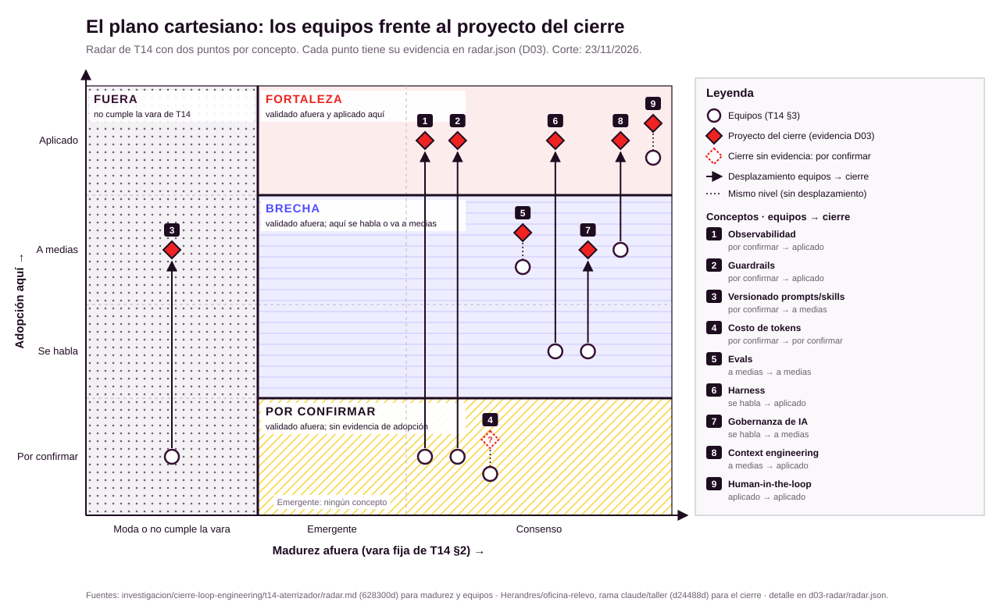

# D03 · El plano cartesiano: los equipos frente al proyecto del cierre

**Tarea D03: agente especialista del plano cartesiano (radar) leyó la investigación y, tomando como base el radar de T14 (9 conceptos con una vara fija), el esqueleto de D01 (§1.5) y la Parte 1 de D02 (§1.5), propone los datos, la figura y la lectura de la sección 1.5 con dos puntos por concepto: los equipos y el proyecto del cierre, cada uno con su evidencia o con «por confirmar».**

Entregables de esta carpeta:
- `radar.json`: un objeto por concepto con madurez afuera (y su fuente con sello) y los dos puntos de adopción con su evidencia. Es la fuente de la figura y de esta lectura.
- `radar.svg`: la figura F6 del esqueleto de D01 (cuadrante 2x2 con dos puntos por concepto). Autocontenida, paleta Triario, legible en blanco y negro (formas, tramas y números, no solo color).
- `radar.md`: este texto.

## Bases leídas

- **Radar de T14:** `investigacion/cierre-loop-engineering/t14-aterrizador/radar.md` (commit `628300d`, 19/11/2026) y las 9 fichas de `t14-aterrizador/fichas/`, más `fichas/archivo.md` (dos vueltas de auditor ciego, nada archivado).
- **Pizarra:** `d01-arquitectura/esqueleto.md` §1.5 (rama `origin/claude/doc-le-d01-arquitectura`), que dejó la primera evidencia del punto del cierre para que D03 la verificara; `d02-marco/parte1.md` §1.5 (rama `origin/claude/doc-le-d02-marco`), con su tabla de dos puntos. D03 verificó cada fila contra el repositorio y actualizó las cifras al corte.
- **El Taller:** `Herandres/oficina-relevo`, rama `claude/taller`, solo lectura, corte en el commit `d24488d` («[CICLO-022] Memoria», 23/11/2026 12:59 UTC). Leídos: `CLAUDE.md`, `CONTRATO.md`, `estado.json`, `proceso/ciclo.md`, `proceso/retro.md`, `proceso/limpieza.md`, `bitacora/ciclos.md` completa, `bitacora/huecos.md` (H-016), `retro/2026-11-21.md`, `decisiones/ADR-006` y `ADR-008`, la cabecera de `tools/integridad.mjs`, y `git log` de esos archivos.
- **Investigación del Relevo:** `t16-supervisor/estado-final.md` (tabla «Horas reales», commit `59c639a`). Búsqueda de «token», «costo» y «/usage» en toda `investigacion/` y en todos los `.md` y `.json` de El Taller.

## Cómo leer las fuentes

- Sellos: [Fuente primaria] · [Fuente secundaria] · [Visto solo en buscador] · [Hipótesis]. Una ruta interna o un commit sin sello es [Fuente primaria].
- Rutas sin prefijo: `Herandres/Skills-triario`, dentro de `investigacion/cierre-loop-engineering/`. Rutas de El Taller: `oficina-relevo:<ruta>`.
- Las fuentes externas llevan el sello que les puso T14. D03 no abrió páginas web.
- **Punto de los equipos:** la columna «Adopción aquí» de `t14-aterrizador/radar.md` §3. T14 la armó con el contexto de su encargo, no con registros de los equipos. Donde T14 dijo «No sé: preguntar a Hernán», aquí dice **por confirmar con Hernán**.
- **Punto del cierre:** evidencia que D03 leyó. El nivel (aplicado, a medias) es juicio de D03 sobre esa evidencia [Hipótesis]; la evidencia misma es [Fuente primaria].

## La figura

- **Eje X, madurez afuera:** moda o no cumple la vara · emergente · consenso (vara fija de `t14-aterrizador/radar.md` §2).
- **Eje Y, adopción aquí:** por confirmar · se habla · a medias · aplicado.
- **Zonas** (definición de T14 §2): **Fortaleza** (validado y aplicado), **Brecha** (validado; se habla o a medias), **Por confirmar** (validado; sin evidencia de adopción), **Fuera** (no cumple la vara).
- **Tramas, para blanco y negro:** Fortaleza lisa, Brecha con rayas horizontales, Por confirmar con rayas diagonales y Fuera con puntos; bordes gruesos entre zonas.
- **Marcas:** círculo = equipos; rombo = cierre; rombo punteado con «?» = cierre sin evidencia. La flecha va de equipos a cierre. Una línea punteada sin punta indica el mismo nivel.

## Lectura por zona

**Fortaleza.** Cinco conceptos tienen el punto del cierre aquí: observabilidad (1), guardrails o barandas (2), harness o arnés del agente (6), context engineering o ingeniería de contexto (8) y human-in-the-loop o persona en el circuito (9). Solo human-in-the-loop ya estaba en Fortaleza del lado de los equipos (T14 §3), así que es el único sin desplazamiento. Los otros cuatro suben: harness desde «se habla», context engineering desde «a medias», y observabilidad y guardrails desde «por confirmar». Cada subida tiene archivo: la bitácora de 25 entradas (tres de CICLO-000: línea base, canario y ajustes; luego una por ciclo de CICLO-001 a CICLO-022) con el veredicto del QA (control de calidad) de cada ciclo (`oficina-relevo:bitacora/ciclos.md`), el contrato de 11 criterios que no cambió desde `b1d5cfa` (`oficina-relevo:CONTRATO.md`), la prueba automática que pasó de 10 criterios en CICLO-001 a 28 en CICLO-022 (`oficina-relevo:tools/qa.mjs`, cifras de `bitacora/ciclos.md`) y la memoria que todo agente lee primero, en un orden fijo (`oficina-relevo:decisiones/ADR-006-memoria-compartida.md`, `CLAUDE.md`). Dos salvedades se dicen sin rodeos: la observabilidad del cierre es **por corrida** (una entrada por ciclo), no por cada llamada al modelo ni con tokens, que es como la definen OpenAI y Anthropic en la ficha de T14; y los guardrails del cierre son chequeos deterministas que frenan la publicación, no hooks (ganchos que corren en puntos fijos del agente) sobre sus herramientas. El Guardián citado en la tabla es `tools/integridad.mjs`, el programa que revisa que la memoria de El Taller solo crezca.

**Brecha.** Dos conceptos quedan en Brecha también en el cierre: evals o evaluaciones automáticas (5) y gobernanza de IA (7). En evals, equipos y cierre están en el mismo nivel, «a medias». El cierre tiene un QA ciego por ciclo, pero ningún conjunto fijo de casos que mida si ese QA acierta. La bitácora muestra 22 de 22 ciclos con producto aprobados en la primera ronda (`oficina-relevo:bitacora/ciclos.md`), y la retro del 21/11 ya lo había anotado: «el QA ciego nunca ha rechazado nada» (`oficina-relevo:retro/2026-11-21.md`, `0455d88`). Eso no prueba que el QA falle, pero tampoco que acierte. Es la misma brecha que T14 puso primera en su lista (`t14-aterrizador/radar.md` §4). La gobernanza sube de «se habla» a «a medias». Las reglas tienen un dueño humano («solo lo cambia Hernán», `oficina-relevo:CONTRATO.md`) y las decisiones quedan registradas (`oficina-relevo:decisiones/`, ADR-001 a ADR-008). En cambio, no hay un inventario de loops ni un marco formal como NIST AI RMF o ISO/IEC 42001. El «consenso» de este concepto viene de T14 y descansa en fuentes vistas solo en el buscador (`t14-aterrizador/fichas/gobernanza-ia.md`).

**Por confirmar.** Aquí empiezan los puntos de los equipos en observabilidad (1), guardrails (2) y costo de tokens (4). Ninguna fuente de la investigación registra la adopción de esos conceptos en los equipos. El BRIEF §3 recoge que, según Hernán, los equipos no han llegado a ellos: queda como **por confirmar con Hernán**. En costo de tokens, también el punto del cierre queda aquí: no se encontró ningún registro de tokens ni de costo. El único indicio es una consecuencia observada, no una medición: «Las rutinas gastaban el uso de una sola cuenta, que se estaba agotando» (`oficina-relevo:decisiones/ADR-008-mudanza-a-data-ia.md`, `424f350`). Por eso el rombo del costo se dibuja punteado y sin flecha.

**Fuera.** Solo el versionado de prompts y skills (3) está en esta zona, porque T14 no encontró un caso publicado de uso en producción con empresa nombrada y el concepto no alcanza la vara de «emergente» (`t14-aterrizador/fichas/versionado-prompts-skills.md`). Estar Fuera no impide medir la adopción. Los equipos están «por confirmar con Hernán» y el cierre está «a medias». Las instrucciones de cada rutina están en git con su línea «Versión» (`oficina-relevo:proceso/ciclo.md`, `proceso/retro.md`, `proceso/limpieza.md`) y el contrato tiene un solo commit en su historia. Lo que falta es registrar qué versión de las instrucciones produjo cada salida (T01 fila 7b, citada en `d01-arquitectura/esqueleto.md` §1.5).

**Sobre la afirmación de Hernán (BRIEF §3).** De los cuatro conceptos que, según Hernán, el cierre implementa y los equipos no, la evidencia sostiene dos como aplicados (observabilidad por corrida y guardrails), uno a medias (versionado) y uno sin evidencia (costo de tokens). El lado de los equipos en los cuatro queda por confirmar con Hernán.

## Tabla de evidencias

| # | Concepto | Madurez afuera (fuente, sello) | Equipos | Evidencia equipos | Cierre | Evidencia cierre |
|---|---|---|---|---|---|---|
| 1 | Observabilidad y trazas | Consenso · Anthropic, sistema multiagente; OpenAI Agents SDK «Tracing» [Fuente primaria] | Por confirmar | Por confirmar con Hernán (T14 §3: «No sé») | **Aplicado**, por corrida | `oficina-relevo:bitacora/ciclos.md` (25 entradas, `d24488d`); `capturas/` (451 archivos); `tools/integridad.mjs` (`f910c04`); `t16-supervisor/estado-final.md` «Horas reales» (`59c639a`) |
| 2 | Guardrails (barandas) | Consenso · OpenAI Agents SDK; NVIDIA NeMo Guardrails [Fuente primaria] | Por confirmar | Por confirmar con Hernán (T14 §3; `fichas/guardrails.md`) | **Aplicado**, deterministas | `oficina-relevo:CONTRATO.md` (11 criterios, `b1d5cfa`); `tools/qa.mjs` (10 → 28 criterios, CICLO-001 → CICLO-022); `tools/integridad.mjs`; `proceso/ciclo.md` pasos 2 y 6 |
| 3 | Versionado de prompts y skills | No cumple la vara · Langfuse [Fuente primaria]; MLflow [Visto solo en buscador]; sin caso de producción | Por confirmar | Por confirmar con Hernán (T14 §3) | **A medias** | `oficina-relevo:proceso/*.md` con línea «Versión» (`f910c04`, `8de7396`); `CONTRATO.md` sin cambios desde `b1d5cfa`; `decisiones/` ADR-001 a ADR-008 |
| 4 | Presupuesto de tokens y costo | Consenso · Claude Code, costs; Anthropic, sistema multiagente [Fuente primaria] | Por confirmar | Por confirmar con Hernán (T14 §3) | **Por confirmar** | Sin registro. Indicio: `oficina-relevo:decisiones/ADR-008-mudanza-a-data-ia.md` (`424f350`) |
| 5 | Evals | Consenso · Anthropic, Demystifying evals [Fuente primaria] | A medias | `t14-aterrizador/radar.md` §3; `fichas/evals.md` | **A medias** | `oficina-relevo:proceso/ciclo.md` paso 7; `bitacora/ciclos.md` (22 de 22 aprobados en primera ronda); `retro/2026-11-21.md` (`0455d88`) |
| 6 | Harness (arnés del agente) | Consenso · Claude Agent SDK; Effective harnesses [Fuente primaria] | Se habla | `t14-aterrizador/radar.md` §3; `fichas/harness.md` | **Aplicado** | `oficina-relevo:CLAUDE.md` (`b1d5cfa`); `proceso/ciclo.md` pasos 0 a 10; `tools/` y `build.mjs` |
| 7 | Gobernanza de IA | Consenso · NIST AI RMF, NIST AI 600-1, ISO/IEC 42001 [Visto solo en buscador] | Se habla | `t14-aterrizador/radar.md` §3; `fichas/gobernanza-ia.md` | **A medias** | `oficina-relevo:CONTRATO.md`; `decisiones/` (ADR-008 «decisión de Hernán», `424f350`); `bitacora/restricciones.md` |
| 8 | Context engineering | Consenso · Anthropic, Effective context engineering; Claude Code, costs [Fuente primaria] | A medias | `t14-aterrizador/radar.md` §3; `fichas/context-engineering.md` | **Aplicado**, sin medir tokens | `oficina-relevo:decisiones/ADR-006-memoria-compartida.md` (`b1d5cfa`); `CLAUDE.md` «Lee en este orden»; `proceso/ciclo.md` paso 7 («SOLO») |
| 9 | Human-in-the-loop | Consenso · Anthropic, Building effective agents [Fuente primaria]; Reglamento UE 2024/1689 art. 14 [Visto solo en buscador] | Aplicado | `t14-aterrizador/radar.md` §3; `fichas/human-in-the-loop.md` | **Aplicado**, en reglas y decisiones | `oficina-relevo:CONTRATO.md`; `bitacora/huecos.md` H-016 («Lo decide Hernán»); `proceso/ciclo.md` (ciclos de la noche sumados por Hernán) |

**Diferencias con la pizarra, corregidas al corte.** D01 escribió que `tools/qa.mjs` pasó de 12 a 21 criterios entre CICLO-005 y CICLO-015, y D02 que pasó de 10 a 22. Leída la bitácora completa al commit `d24488d`, el primer registro es de 10 criterios (CICLO-001) y el último de 28 (CICLO-022). Las cifras de D01 y D02 corresponden a cortes anteriores. En human-in-the-loop, el cierre aplica la puerta humana a las reglas y a las decisiones sin vuelta atrás, no a cada publicación: el paso 8 de `oficina-relevo:proceso/ciclo.md` publica la versión cuando el QA aprueba, sin esperar a una persona.

## Dónde está la innovación

- **El radar se mueve.** Un radar de tecnología es una foto: dice dónde está cada concepto. Este pone dos puntos por concepto y una flecha entre ellos. Así se ve cuánto avanzó el proyecto del cierre frente a los equipos, concepto por concepto (`radar.svg`). La flecha nace de la definición de Hernán para la Parte 1 (BRIEF §3). Que otros radares no la usen es una observación de D03 sobre el formato habitual de los radares de tecnología, sin una fuente que la respalde [Hipótesis].
- **Cada punto es auditable.** La figura sale de `radar.json`, que guarda la ruta o el commit de cada punto. Esto aplica al cierre la misma idea de linaje que el BRIEF le pide al loop («bitácora ↔ linaje», BRIEF §2, eje 1).
- **El dogfooding (usar la propia técnica para construir el producto) se ve en la figura.** Cuatro de los cinco rombos en Fortaleza (observabilidad, guardrails, harness y context engineering) se apoyan en archivos que El Taller produjo para construirse a sí mismo: la bitácora, el contrato, el Guardián y la memoria compartida. El quinto, human-in-the-loop, se apoya en las reglas que solo cambia Hernán. Según las fechas de sus commits (19 a 23/11/2026, `b1d5cfa`, `f910c04`, `d24488d`), son anteriores a este Relevo de documentación o paralelos a él y salieron del trabajo de los ciclos; que ninguno se escribiera pensando en el informe es lectura de D03 [Hipótesis].
- **Lo que no se sostiene queda a la vista.** Evals se queda en Brecha y el costo de tokens en Por confirmar. Esos puntos se dejaron tal como salieron de la evidencia, sin mejorarlos para la figura.

---

## Auditoría ciega

Un subagente nuevo, que no vio el proceso de D03, recibió solo `BRIEF.md`, `radar.json`, `radar.svg` y `radar.md`. Renderizó la figura en color y en escala de grises.

**Veredicto: aprobado con correcciones menores, sin cambios de datos.**

| Criterio | Veredicto del auditor |
|---|---|
| a) Fuentes en cada afirmación | Cumple: cada nivel y cada cifra tiene ruta, commit o enlace con sello. |
| b) Datos inventados y coherencia | Cumple con dos salvedades: una frase de la innovación sin sello; «25 entradas» frente a 23 ciclos sin explicar. Json, svg y md coinciden en niveles y zonas. |
| c) Decisiones de Hernán | Cumple; la sección de auditoría vacía se leía como pendiente. |
| d) Innovación visible | Cumple: flechas de equipos a cierre y puntos que no se sostienen a la vista. |
| e) Claridad ejecutiva | Cumple con detalles: QA, hooks, Guardián, set dorado y diff sin traducir; en gris, Fortaleza y Brecha se confundían; la nota «Emergente: ningún concepto» parecía de Brecha. |

**Lo que cambió D03 después del veredicto:**
1. La frase «ninguno se escribió para el informe» ahora cita las fechas de los commits y lleva [Hipótesis].
2. Se explica que las 25 entradas de la bitácora son tres de CICLO-000 y una por ciclo de CICLO-001 a CICLO-022 (md y json).
3. Esta sección reemplaza al marcador vacío.
4. Se tradujeron QA, hooks y Guardián en el md, y set dorado (golden set) y diff en el json.
5. Figura: Brecha lleva rayas horizontales, los bordes entre zonas son gruesos, la nota de la columna emergente bajó al pie y la caja de «POR CONFIRMAR» ya no roza la placa del concepto 4.
6. Se anotó que el consenso de gobernanza descansa en fuentes vistas solo en el buscador.
